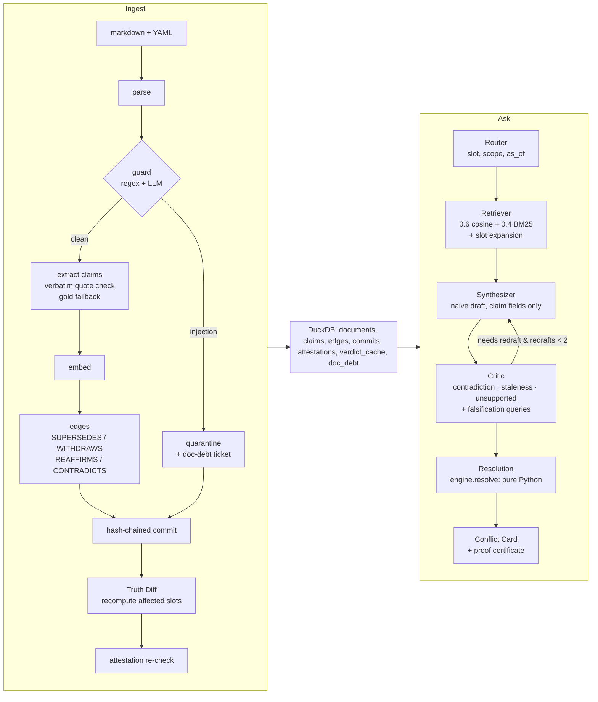

# Architecture

## Data flow

Key separation: **only the extractor ever sees raw document text.** Synthesizer, critic and resolution see claim
fields (`value`, `unit`, `quote`, metadata). The engine does no I/O and calls no LLM; the final answer text is
templated from its verdict.

## Bitemporal model

Each claim has valid time `effective_from` and knowledge time `recorded_at`. Claims load only when
`effective_from <= as_of AND recorded_at <= known_as_of AND doc not quarantined`. Audit replay sets
`known_as_of` to the past: "what did we say on 1 Feb" differs from "what was true on 1 Feb as we know now" when a
document (here RESC, effective 15 Jan, recorded 1 Mar) arrived late.

## Resolution engine (`truthguard/engine.py`)

Precedence cascade, **fixed order**: authority before specificity.

| Rule | Name | Applies when | Effect |
|---|---|---|---|
| R1 | Declared | SUPERSEDES / WITHDRAWS edge exists | declaring claim attacks target |
| R2 | Lex superior | different authority tiers | higher tier attacks lower |
| R3 | Lex specialis | same tier, one scoped, one general | scoped attacks general |
| R4 | Lex posterior | same tier & specificity, different `effective_from` | later attacks earlier |
| R5 | Tie | otherwise | mutual attack → UNDECIDED |

Why R2 before R3: with R3 first, the tier-1 Prepaid FAQ ("7 days") would beat the tier-3 Billing Policy v2
("30 days") for prepaid users. Tests `test_q5_old_rule_order_gives_7_fixed_gives_30` and the `--old-rule-order`
ablation guard this.

**Echo collapsing:** in-play value claims are grouped by `(normalised value, scope)`; the member with the highest
`(tier, effective_from)` is the representative, the rest are *echoes*: no weight, no attacks, they inherit the
representative's label and are listed under it ("also stated by"). This stops FAQ-2025 from appearing as a third
side of the CDR-retention conflict.

**Grounded extension** of the attack graph labels every node IN / OUT / UNDEC. Verdicts:

| Status | Condition |
|---|---|
| UNSUPPORTED | no in-play value claim, or nothing IN and < 2 UNDEC |
| ATTESTED | an IN winner is an attestation (tier 0) |
| CONTESTED | nothing IN, ≥ 2 UNDEC |
| SUPERSEDED | IN winner exists and some value claim is OUT |
| SETTLED | exactly one IN, nothing OUT |

Withdrawal claims (kind `withdrawal`, `target_doc`) are graph nodes that attack every claim of the target
document, so when RESC withdraws AMD-3 the attack on BP-V2 vanishes and BP-V2 is reinstated.

## Agents

* **Router**: structured output `{slot, scope, as_of}`; UI-supplied scope/as_of override; fallback is cosine of the
  question vs slot descriptions (threshold 0.45).
* **Retriever**: hybrid top-6 plus *slot expansion* (all in-play claims of the slot, 1-hop SUPERSEDES/WITHDRAWS
  neighbours, withdrawal claims). Each claim is tagged `similarity` / `expansion` / `falsification`.
* **Synthesizer**: allowed to be naive; cites claim ids; hallucinated ids are dropped.
* **Critic**: CONTRADICTS / STALE / UNSUPPORTED attacks (+ falsification queries that try to disprove the draft
  and may add new evidence). Never edits the draft. `needs_redraft` loops back at most twice.
* **Resolution**: runs the engine over the evidence set, builds the Conflict Card, templates the answer, creates
  doc-debt tickets (CONTESTED / UNSUPPORTED), and attaches a proof certificate
  `{claim_ids, quote_found, supported, no_open_attack}`; if any check fails the answer is withheld.

## Other components

* **Ledger**: `hash = sha256(parent_hash + doc_id + doc_sha256 + recorded_at.isoformat())`, genesis parent `"0"*64`;
  `verify_chain()` returns `(ok, first_bad_seq)`.
* **Truth Diff**: recompute affected slots × {general, enterprise, prepaid} at today, diff against `verdict_cache`
  (rebuilds "before" by excluding the new doc on a cache miss), report the deciding rule.
* **Attestations**: tier-0 value claims, in play only while active and unexpired; a document claim that echoes
  the value marks them `documented`, one that defeats them marks them `contradicted`.
* **Injection guard**: regex patterns + LLM classifier → quarantine (still committed for audit, no claims).
